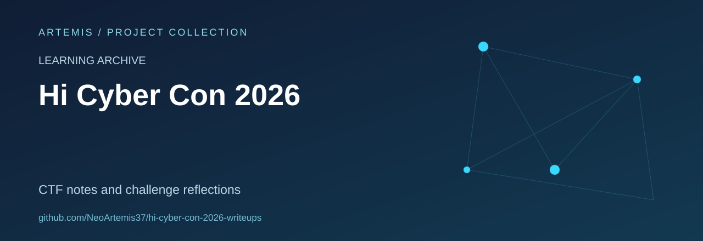

# HI Cyber Con 2026 Write-ups

French-language notes documenting challenge analysis, recovered evidence and the limits of what could be reconstructed after the competition.

**Status:** learning archive containing complete write-ups and partial analyses. A challenge being solved during the event does not mean that its complete method has been recovered here.

## Start here

- [Challenge inventory](docs/inventaire.md).
- [Provenance and verification notes](docs/provenance.md).
- [Missing material and remaining gaps](docs/lacunes.md).
- [Artefact guide](docs/artifacts.md).
- [Write-up format](docs/format-writeup.md).

## What is included

The `writeups/` directory contains 18 challenge dossiers across cryptography, forensics, networking, reverse engineering, OSINT, steganography, Android and miscellaneous topics. The existing index distinguishes eight complete solutions from ten partial analyses.

| Path | Contents |
| --- | --- |
| `writeups/` | Individual challenge notes |
| `data/challenges.json` | Challenge inventory |
| `data/sources.json` | Source records |
| `docs/` | Provenance, format and completeness notes |
| `assets/validation/` | Included validation illustrations |
| `scripts/` | Offline artefact-handling helpers |

## Reading the archive

Read the status and dependencies recorded on each page. Historical output, results reproduced later and incomplete material should remain distinguishable. Some large originals are described as belonging to a separate artefact archive; their availability is not guaranteed by this Git repository.

## Contributions

Corrections are especially useful when they supply a source, clarify a missing step in a lab analysis, or distinguish a confirmed result from an assumption. Preserve challenge-author attribution and the original context of supplied materials.

## Scope

This repository documents competition and laboratory learning. It does not represent client assessments or a record of professional security engagements. No repository-wide licence file is currently included; third-party challenge material retains its original attribution and terms.
