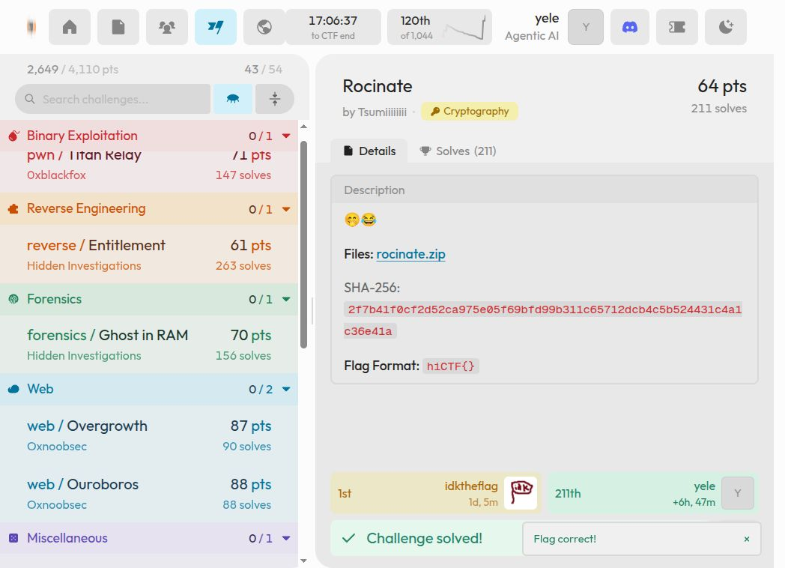

# Rocinate

**HI Cyber Con 2026 · Cryptographie · Tsumiiiiiiii · Résolu**

## Énoncé et artefacts

La fiche donne deux émojis et l'archive `rocinate.zip`, sans consigne textuelle supplémentaire. Le but déduit du code est de récupérer le secret utilisé pour produire les données. [Consigne conservée](../../artifacts/rocinate/statement.md).

| Fichier | Contenu |
| --- | --- |
| [rocinate.zip](../../artifacts/rocinate/input/rocinate.zip) | Archive originale, 118 482 octets |
| [chall.py](../../artifacts/rocinate/input/chall.py) | Générateur fourni |
| [chall.txt](../../artifacts/rocinate/input/chall.txt) | Paramètres et 100 échantillons |
| [recover_state.py](../../artifacts/rocinate/scripts/recover_state.py) | Reconstruction de MT19937 |
| [recover_flag.py](../../artifacts/rocinate/scripts/recover_flag.py) | Remontée du générateur et récupération du flag |

Toutes les commandes partent de la racine du dépôt. Python 3 et sa bibliothèque standard suffisent aux solveurs. Les commandes de résolution ci-dessous ont été retestées le 3 novembre 2026.

## 1. Vérifier l'archive

```bash
sha256sum artifacts/rocinate/input/rocinate.zip
unzip -Z -1 artifacts/rocinate/input/rocinate.zip
```

Résultat obtenu :

```text
2f7b41f0cf2d52ca975e05f69bfd99b311c65712dcb4c5b524431c4a1c36e41a  artifacts/rocinate/input/rocinate.zip
chall.py
chall.txt
```
Les deux fichiers sont déjà extraits dans `artifacts/rocinate/input/`. La lecture du générateur donne les relations :

```python
Cs = [random.randint(1, N) for _ in range(n)]
Zs = [ri * pow(s, ci, N) for ri, ci in zip(Rs, Cs)]
Ts = [pow(ri, e, N) for ri in Rs]
```

Les exposants `C` révèlent des sorties de MT19937. Les `Z` sont des produits entiers exacts : une fois `ri` retrouvé, la division rend `s**ci mod N`.

## 2. Reconstruire le générateur

Le premier script décompose les exposants en mots de 32 bits, inverse le tempering et recherche dix tirages consécutifs. Neuf bits manquants sont départagés avec les sorties suivantes et la logique de rejet de `randint`.

```bash
python artifacts/rocinate/scripts/recover_state.py
```

Résultat obtenu :

```text
accept probability 0.7809683578056172
runs [15, 16, 17, 18, 19, 20, 21, 22, 23, 24]
FOUND 15 471
```

Le premier état cohérent commence à `C[15]`. Il est écrit dans [recovered_state.json](../../artifacts/rocinate/results/recovered_state.json).

## 3. Retrouver les masques et le secret

Le second script remonte le générateur, retrouve `e` et `r0`, puis régénère les cent états de la récurrence affine. Pour deux exposants premiers entre eux, Bézout donne `u*C[0] + v*C[i] = 1` ; la combinaison des puissances correspondantes donne le secret modulo `N`.

```bash
python artifacts/rocinate/scripts/recover_flag.py
```

Résultat obtenu :

```text
accepted 19 start 15 C back match True
b match True a match True
all divisions True
all powers True
FLAG b'hiCTF{lmaoooo_w0t???y0u_d1d_17_??435p37++}'
all ciphertexts True
```

Les cent divisions sont exactes, les cent `T` sont reproduits et le secret reproduit les cent puissances. La résolution est vérifiée sur tout le jeu, sans factoriser `N`.

## Flag

```text
hiCTF{lmaoooo_w0t???y0u_d1d_17_??435p37++}
```

[Notes de session](../../artifacts/rocinate/results/session-notes.txt) · [Validation conservée](../../assets/validation/rocinate.png)



[Retour à l’index](../../README.md)
