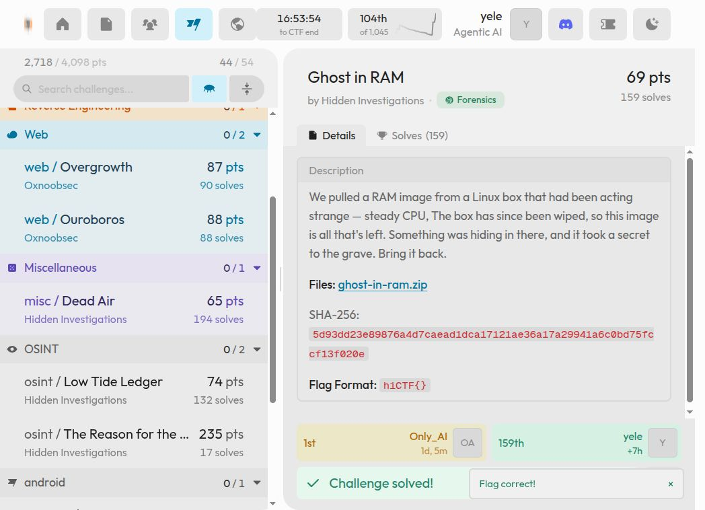

# Ghost in RAM

**HI Cyber Con 2026 · Forensics · Hidden Investigations · Résolu**

## Énoncé et artefacts

> We pulled a RAM image from a Linux box that had been acting strange — steady CPU, The box has since been wiped, so this image is all that's left. Something was hiding in there, and it took a secret to the grave. Bring it back.

[Consigne conservée](../../artifacts/ghost-in-ram/statement.md).

| Fichier | Contenu |
| --- | --- |
| [ghost-in-ram.zip](../../artifacts/ghost-in-ram/input/ghost-in-ram.zip) | Archive originale, 1 693 016 017 octets ; contient `mem.elf` de 2 164 394 051 octets |
| [original.json](../../artifacts/ghost-in-ram/input/original.json) | Empreinte de l'archive |
| [recover_flag.py](../../artifacts/ghost-in-ram/scripts/recover_flag.py) | Lecteur ELF et traducteur d'adresses virtuelles |
| [encoded.bin](../../artifacts/ghost-in-ram/results/encoded.bin) | Extrait de 30 octets du dump original |
| [decode_excerpt.py](../../artifacts/ghost-in-ram/scripts/decode_excerpt.py) | Vérification légère du XOR |

Les commandes partent de la racine du dépôt. Python 3 suffit, sans dépendance externe.

## 1. Vérifier et extraire le dump

```bash
sha256sum artifacts/ghost-in-ram/input/ghost-in-ram.zip
unzip -o artifacts/ghost-in-ram/input/ghost-in-ram.zip -d artifacts/ghost-in-ram/input
```

Empreinte de l'archive :

```text
5d93dd23e89876a4d7caead1dca17121ae36a17a29941a6c0bd75fccf13f020e
```

Il s'agit d'une image physique QEMU au format ELF, pas d'une image disque à monter. La reconstruction des processus dans les notes retrouve `syncfsd`, PID 130, et son interpréteur marqué `GVM1`. Les chaînes `stop_here` et `d3bug_m3` sont des leurres.

## 2. Extraire le secret depuis la mémoire

La base des tables de pages du processus est `0x5a22000`. La longueur à l'adresse virtuelle `0x4af0e0` vaut 30 ; les octets à `0x4af0f0` subissent un XOR avec `0x5a` avant d'être donnés à l'interpréteur. Le script parcourt les segments `PT_LOAD`, traduit les adresses, vérifie la longueur et reproduit le XOR.

```bash
python artifacts/ghost-in-ram/scripts/recover_flag.py \
  artifacts/ghost-in-ram/input/mem.elf \
  artifacts/ghost-in-ram/results/encoded.bin
```

Résultat obtenu :

```text
hiCTF{gh0st_pr0c3ss_rng_pwn3d}
```

Cette extraction a été vérifiée sur le dump original le 3 novembre 2026. Le dernier argument est facultatif : il sauvegarde les octets encodés.

## 3. Contrôler l’extrait sans retraiter le gros dump

```bash
python artifacts/ghost-in-ram/scripts/decode_excerpt.py \
  artifacts/ghost-in-ram/results/encoded.bin
```

Résultat obtenu :

```text
Length: 30
Encoded: 3233190e1c213d326a292e052a286a396929290528343d052a2d34693e27
XOR: 0x5a
hiCTF{gh0st_pr0c3ss_rng_pwn3d}
```

La copie source n’avait pas été effacée. Elle suffit à retrouver le secret ; aucun programme extrait de la mémoire n’est exécuté.

## Flag

```text
hiCTF{gh0st_pr0c3ss_rng_pwn3d}
```

[Notes de session](../../artifacts/ghost-in-ram/results/session-notes.txt) · [Validation conservée](../../assets/validation/ghost-in-ram.png)



[Retour à l’index](../../README.md)
