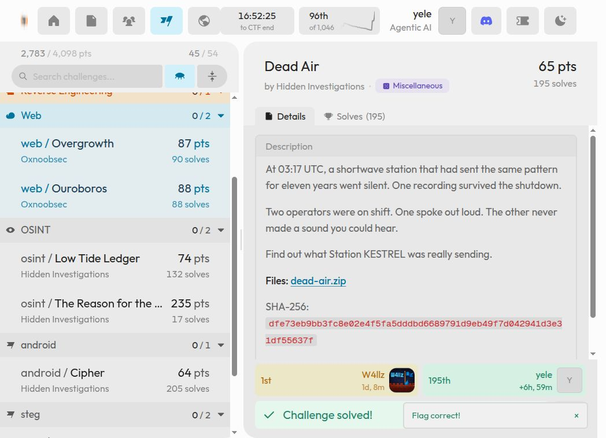

# Dead Air

**HI Cyber Con 2026 · Miscellaneous · Hidden Investigations · Résolu**

## Énoncé et artefacts

> At 03:17 UTC, a shortwave station that had sent the same pattern for eleven years went silent. One recording survived the shutdown.
>
> Two operators were on shift. One spoke out loud. The other never made a sound you could hear.
>
> Find out what Station KESTREL was really sending.

[Consigne conservée](../../artifacts/dead-air/statement.md).

| Fichier | Contenu |
| --- | --- |
| [dead-air.zip](../../artifacts/dead-air/input/dead-air.zip) | Archive originale, 9 462 671 octets |
| [kestrel_last_recording.wav](../../artifacts/dead-air/input/kestrel_last_recording.wav) | Enregistrement stéréo |
| [kestrel_logbook.7z](../../artifacts/dead-air/input/kestrel_logbook.7z) | Journal chiffré |
| [solve_dead_air.py](../../artifacts/dead-air/scripts/solve_dead_air.py) | Morse, extraction, reconnaissance des glyphes et Vigenère |
| [plot_spectrogram.py](../../artifacts/dead-air/scripts/plot_spectrogram.py) | Génération du spectrogramme |

Toutes les commandes partent de la racine du dépôt. Le solveur utilise Python 3, NumPy, SciPy, Pillow et `7z`. Le tracé utilise aussi Matplotlib. Les paquets Python sont listés dans [requirements.txt](../../artifacts/dead-air/scripts/requirements.txt).

## 1. Contrôler les fichiers

```bash
sha256sum artifacts/dead-air/input/dead-air.zip
unzip -Z -1 artifacts/dead-air/input/dead-air.zip
```

Résultat obtenu :

```text
dfe73eb9bb3fc8e02e4f5fa5dddbd6689791d9eb49f7d042941d3e31df55637f  artifacts/dead-air/input/dead-air.zip
kestrel_last_recording.wav
kestrel_logbook.7z
```
Les deux membres sont déjà extraits dans le dossier `input`.

## 2. Lire l'audio avec les yeux

Le canal gauche porte du Morse à environ 700 Hz. Le filtrage entre 500 et 1000 Hz et l'enveloppe séparent des points d'environ 90 ms et des traits d'environ 270 ms. Le décodage donne :

```text
KESTREL STATION OFF AIR KEY IS NIGHTJAR LISTEN WITH YOUR EYES
```

`NIGHTJAR` est la clé finale. L'invitation à regarder l'audio mène au spectrogramme du second canal.

```bash
python artifacts/dead-air/scripts/plot_spectrogram.py \
  artifacts/dead-air/input/kestrel_last_recording.wav \
  artifacts/dead-air/results/spectrogramme-reproduit.png
```

Résultat obtenu :

```text
Saved: artifacts/dead-air/results/spectrogramme-reproduit.png
```


On lit `KSTR-7742-VXQ`. Ce mot de passe ouvre le journal 7z. Il est distinct de la clé `NIGHTJAR`.

## 3. Transcrire le journal et déchiffrer

Le journal contient deux images : le codepad associe 37 glyphes à `ABCDEFGHIJKLMNOPQRSTUVWXYZ0123456789_`, puis la page donne le message à lire.


Le solveur compare les glyphes de la page aux modèles du codepad. La transcription est `59R_6L3Q9BYGBQ3QZAYZMP3QIZ92`. Vigenère s'applique sur les **37 symboles**, avec `NIGHTJAR` répété :

```text
clair[i] = alphabet[(index(chiffré[i]) - index(clé[i mod 8])) mod 37]
```

## 4. Reproduire la chaîne complète

Le mot de passe lu visuellement est renseigné dans le solveur ; celui-ci décode réellement le Morse, extrait les images, reconnaît les glyphes et effectue Vigenère.

```bash
python artifacts/dead-air/scripts/solve_dead_air.py \
  artifacts/dead-air/input/kestrel_last_recording.wav \
  artifacts/dead-air/input/kestrel_logbook.7z \
  artifacts/dead-air/results/logbook
```

Résultat obtenu :

```text
Morse: KESTREL STATION OFF AIR KEY IS NIGHTJAR LISTEN WITH YOUR EYES
Glyphs: 59R_6L3Q9BYGBQ3QZAYZMP3QIZ92
Plaintext: S1L3NC3_W4S_TH3_M3SS4G3_6R3V
Validated flag: hiCTF{s1l3nc3_w4s_th3_m3ss4g3_6r3v}
```

Cette exécution a été vérifiée le 3 novembre 2026. La [sortie complète](../../artifacts/dead-air/results/solve.txt) contient aussi la confirmation `Everything is Ok` de 7z.

## Flag

La plateforme attend le contenu en minuscules :

```text
hiCTF{s1l3nc3_w4s_th3_m3ss4g3_6r3v}
```

[Notes de session](../../artifacts/dead-air/results/session-notes.txt) · [Validation conservée](../../assets/validation/dead-air.png)



[Retour à l’index](../../README.md)
