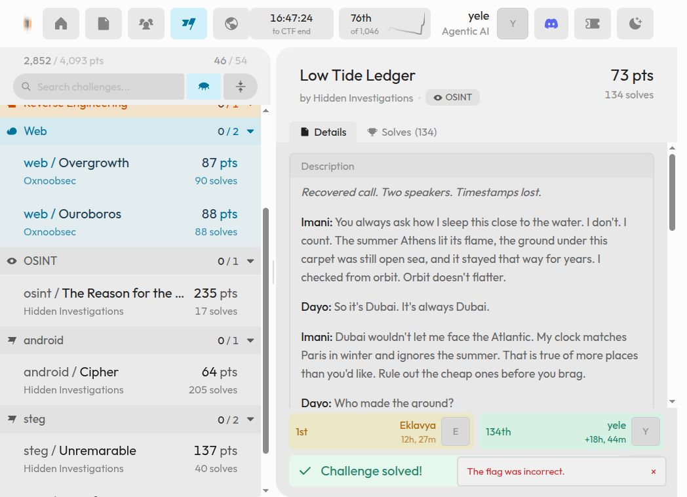

# Low Tide Ledger

**HI Cyber Con 2026 · OSINT · Hidden Investigations · Résolu**

## Énoncé et artefacts

La fiche présente un appel récupéré entre Imani et Dayo, sans horodatage. Le début conservé contient ces indices : un sol encore en pleine mer lors des Jeux d'Athènes, une vue vers l'Atlantique et une heure identique à Paris en hiver, sans changement d'heure en été.

> Recovered call. Two speakers. Timestamps lost.

Le [fragment original de la conversation](../../artifacts/low-tide-ledger/statement.md) est transcrit séparément. La capture ne conserve pas la suite de l'énoncé ; elle n'est pas inventée ici.

| Fichier | Contenu |
| --- | --- |
| [low-tide-ledger.zip](../../artifacts/low-tide-ledger/input/low-tide-ledger.zip) | Archive originale, 943 239 octets |
| [room.jpg](../../artifacts/low-tide-ledger/input/room.jpg) | Photographie fournie, conservée sans modification |
| [inspect_image.py](../../artifacts/low-tide-ledger/scripts/inspect_image.py) | Vérification du format, des dimensions et du GPS EXIF |
| [plaque-3C.png](../../artifacts/low-tide-ledger/results/plaque-3C.png) | Capture historique de la visite publique et du numéro d'appartement |

Les commandes partent de la racine du dépôt. Python 3 et Pillow suffisent au contrôle de l'image. La localisation repose ensuite sur la comparaison visuelle effectuée pendant le CTF.

## 1. Vérifier le fichier reçu

```bash
sha256sum artifacts/low-tide-ledger/input/low-tide-ledger.zip
unzip -Z -1 artifacts/low-tide-ledger/input/low-tide-ledger.zip
```

Résultat obtenu :

```text
6b3cef6e7cfef60459036b216bce5de10d9d25773b4f571604a4730246e591f2  artifacts/low-tide-ledger/input/low-tide-ledger.zip
room.jpg
```

```bash
python artifacts/low-tide-ledger/scripts/inspect_image.py \
  artifacts/low-tide-ledger/input/room.jpg
```

Résultat obtenu :

```text
File: room.jpg
Format: PNG
Dimensions: 1246 832
Mode: RGBA
EXIF GPS: absent
```
Ce contrôle a été exécuté le 3 novembre 2026. Le nom `.jpg` est trompeur : le fichier est un **PNG RGBA**, sans coordonnées GPS EXIF. Il faut travailler avec les indices de la conversation et le contenu visuel.


## 2. Identifier la ville gagnée sur la mer

La combinaison du remblai récent, de l'Atlantique et du fuseau horaire conduit à **Eko Atlantic City**, à **Lagos, au Nigeria**. Le groupe de tours est **Eko Pearl Towers**.

Les notes de la session citent la [FAQ officielle d'Eko Atlantic](https://www.ekoatlantic.com/faq) et une [annonce immobilière](https://nigeriapropertycentre.com/for-rent/flats-apartments/lagos/eko-atlantic-city/3726311-3-bedroom-flat). Ces références font partie de la démarche historique, sans nouvelle recherche pendant cette reproduction.

## 3. Retrouver l'intérieur et le numéro d'appartement

La [visite publique associée à Nairahomes Realty](https://www.google.com/maps/place/Nairahomes+Realty/@6.4097037,3.4108708,3a,37.5y,232.93h,100t/data=!3m8!1e1!3m6!1sCIHM0ogKEICAgICmj4q_0gE!2e10!3e11!7i13416!8i6708) avait permis de comparer les canapés bruns, les coussins roses et bleu-vert, les rideaux et les chaises avec la photographie.

Dans le panorama de l'entrée, la plaque porte **3C**. La capture conserve également l'attribution publique de la visite à ONYEOMADESIGN.


## 4. Assembler la réponse

Les cinq éléments établis dans les notes sont :

```text
Projet       Eko-Atlantic-City
Ville        Lagos
Pays         Nigeria
Agence       Nairahomes-Realty
Appartement  3C
```

Le nom complet `Eko-Atlantic-City` compte : la variante limitée à `Eko-Atlantic` a été rejetée.

## Flag

```text
hiCTF{Eko-Atlantic-City_Lagos_Nigeria_Nairahomes-Realty_3C}
```

[Réponse enregistrée](../../artifacts/low-tide-ledger/results/flag.txt). La capture ci-dessous affiche l'état « Challenge solved! » et conserve aussi le toast d'un essai rejeté ; les notes de session identifient la réponse finale ci-dessus.

[Notes de session](../../artifacts/low-tide-ledger/results/session-notes.txt) · [Validation conservée](../../assets/validation/low-tide-ledger.png)



[Retour à l’index](../../README.md)
